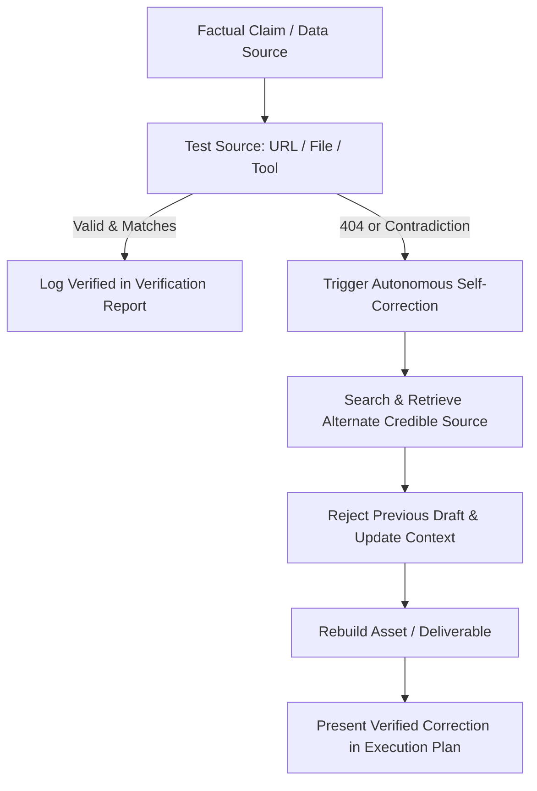

# Strict Reference Verification & Self-Correction

Operational skill to guarantee high-integrity claims, citations, and datasets. Every factual assertion, statistic, and external link is actively validated before presentation.

---

## Core Protocol

Every time a factual claim, statistic, academic reference, or data source is introduced into a deliverable or response:

1. **Source Tracking (Subtask Isolation)**
   - Group verification into an explicit subtask or execution phase.
   - Catalog each individual assertion alongside its intended source (URL, dataset column/file, literature DOI).

2. **Interactive Testing (Live Grounding)**
   - **Local Datasets**: Inspect actual tabular columns, records, or summary statistics via filesystem tools or data processing scripts.
   - **External Links & URLs**: Check HTTP reachability and verify that the target page contains the exact figures cited (avoid assumptions or hallucinations).
   - **Academic Literature**: Confirm authors, year, publication title, and volume/issue via DOI lookups or scholarly tools.

3. **Artifact Creation (Verification Report)**
   - Produce a structured `Verification Report` artifact logging all checked claims, target URLs/paths, and match outcomes.
   - Refer to the [Verification Report Template](./resources/verification-report-template.md) for standard fields.

---

## Autonomous Self-Correction Loop

When a source fails validation (e.g., HTTP 404, broken link, paywalled/withdrawn paper, or numerical mismatch between text and data):

### Self-Correction Rules:
- **Mandatory Retry**: If a target URL returns 404, or if source data contradicts the written claim, you **MUST** trigger an autonomous retry to locate an alternate authoritative source.
- **Draft Rejection**: Immediately discard the unverified draft. Recompute values or rewrite claims to match the newly verified evidence.
- **Context Synchronization**: Update internal working context with the confirmed facts.
- **Clean Communication**: **DO NOT** present raw error logs or verbose HTTP tracebacks to the user. Instead, explain the verified correction directly within the final execution plan or report.
