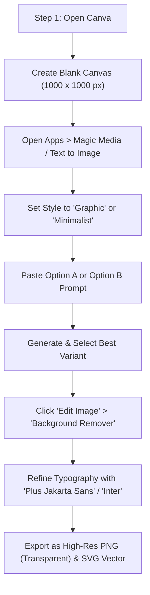

# Project Avatar: Brand Identity & Canva AI Logo Generation Guide
**High-Resolution Multi-Hazard Epidemiological Intelligence Platform**  
*Philippine Junior Data Science Challenge (PJDSC) 2026*  
*Document Identifier:* [`docs/BRANDING_GUIDE.md`](file:///c:/Users/Hannah/Desktop/Hannah's%20lab/PJDSC/docs/BRANDING_GUIDE.md)

---

## 1. Executive Brand Essence & Creative Mandate

**Project Avatar** (also branded as **Avatar.IQ**) is a pioneering multi-hazard spatial health intelligence platform developed for Megacity Metro Manila. It unites flood-induced leptospirosis surge forecasting, fine-scale 1.0 km² $PM_{2.5}$ atmospheric downscaling, and clinical decision support under statutory privacy guardrails (RA 10173).

### The Visual Mandate: All Elements Must Be Clearly Visible
To reflect the multi-hazard nature of the platform, the brand logo cannot be an abstract blob or a generic medical cross. **Every primary functional pillar must have an unmistakable, visually distinct representation in the mark:**

```
               [ 1. GEOMETRIC SHIELD / HEXAGONAL FRAME ]
             Outer protective boundary: Public Health Defense & RA 10173
                                     │
         ┌───────────────────────────┴───────────────────────────┐
         ▼                                                       ▼
[ 2. ATMOSPHERIC AEROSOL ARC ]                        [ 3. SPATIAL DATA GRID & NODES ]
Upper-left: Fine PM2.5 breeze arc,                    Upper-right: 1.0 km² coordinate mesh
aerosol particle rings (#06B6D4)                      & interconnected data points (#CBD5E1)
         │                                                       │
         └───────────────────────────┬───────────────────────────┘
                                     ▼
                   [ 4. MEDICAL VITALITY PULSE / CROSS ]
                 Center core: Clinical prophylaxis & lives saved
                 Lit with Solar Amber glow (#FF5B14)
                                     │
                                     ▼
                   [ 5. INUNDATION SURGE WAVE / CREST ]
                 Lower foundation: Floodwaters, 14-day rainfall lag,
                 leptospirosis waterborne vector (#0284C7 / #06B6D4)
                                     │
                                     ▼
                   [ 6. TYPOGRAPHIC WORDMARK: AVATAR.IQ ]
                 Plus Jakarta Sans / Bold Tech Geometric Sans-Serif
```

---

## 2. Official Brand Design Tokens & Palette

| Token Name | Hex Code | RGB | Role & Meaning in Logo |
| :--- | :--- | :--- | :--- |
| **Solar Amber** *(Primary Accent)* | `#FF5B14` | `255, 91, 20` | Outbreak surge horizon, active focal node, clinical urgency, warmth of frontline care. |
| **Atmospheric Cyan** | `#06B6D4` | `6, 182, 212` | $PM_{2.5}$ air quality downscaling, clean breeze, satellite aerosol optical depth. |
| **Inundation Azure** | `#0284C7` | `2, 132, 199` | Hydrometeorological floodwaters, monsoon rainfall lag dynamics, water vector. |
| **Carbon Charcoal** | `#15171A` | `21, 23, 26` | Deep intelligence foundation, bento-grid executive contrast, statutory authority. |
| **Obsidian Navy** | `#0F172A` | `15, 23, 42` | High-contrast structural boundaries, primary text, dark mode badge canvas. |
| **Emerald Vitality** | `#10B981` | `16, 185, 129` | Prophylaxis efficacy, safety compliance (RA 10173 $k \ge 5$), recovered patients. |
| **Pure Alabaster** | `#FFFFFF` | `255, 255, 255` | Crisp light background, vector cutout negative space, clarity. |

---

## 3. Element Visibility Matrix (Audit Checklist)

When reviewing the Canva AI generation, confirm that each of these **6 mandatory elements** is individually identifiable:

- [ ] **Element 1: Protective Hex-Shield Contour** — Crisp, symmetrical geometric container holding the composition together.
- [ ] **Element 2: Curving Flood Wave / Inundation Crest** — Sweeping cleanly across the bottom half of the emblem.
- [ ] **Element 3: Atmospheric Particles / Air Stream Arc** — Floating softly in the upper quadrant, representing air quality surveillance.
- [ ] **Element 4: Coordinate Grid / Interconnected Data Nodes** — Geometric lattice dots or intersecting lines symbolizing AI/ML data fabric.
- [ ] **Element 5: Clinical Vitality Pulse / Medical Cross Core** — Glowing at the heart of the symbol, bridging environmental hazard with human health.
- [ ] **Element 6: High-Contrast Modern Wordmark** — Bold "AVATAR" with illuminated ".IQ" pill/accent.

---

## 4. Ready-to-Feed Canva AI Prompts

> **Pro-Tip for Canva Magic Media / Text to Image:**  
> Canva AI generates best when given structured spatial anchors ("in the center", "at the base", "in the upper corner"). Choose **Style: "Graphic"**, **"Vector"**, or **"Minimalist"** in Canva for the sharpest results.

### Option A: The Master Multi-Hazard Emblem (Recommended)
*Use this prompt to generate the complete standalone emblem where all 6 elements are clearly separated.*

```text
Modern minimalist vector tech-health logo emblem inside a sleek geometric shield silhouette, isolated on a solid white background. All elements must be clearly visible and delineated: at the bottom base is a sharp stylized blue ocean flood wave (#0284C7); in the center is a glowing vibrant solar orange medical cross pulse icon (#FF5B14); on the upper right is an isometric digital coordinate data grid with three connected glowing dot nodes (#CBD5E1); on the upper left are two graceful curving cyan atmospheric airflow breeze lines with tiny particle dots (#06B6D4). Crisp flat 2D graphic design, premium Swiss healthcare intelligence branding, bold clean vector lines, high contrast, SVG logo aesthetic, zero clutter, no blurry 3D gradients, professional corporate mark.
```

---

### Option B: High-Contrast Dark Mode Executive Badge (Command Center)
*Ideal for the pitch deck title slide, dark mode bento grid, and executive command bar.*

```text
Executive dark mode app icon badge, rounded square container in obsidian charcoal (#15171A) with subtle neon glow rim. Inside the badge, all multi-hazard elements are sharply visible with glowing neon vector linework: a stylized curved aqua water surge wave at the bottom base (#06B6D4), a bright solar amber medical vitality pulse emblem in the center (#FF5B14), a fine white geometric satellite data grid with connected network nodes on the upper side, and subtle atmospheric air particle rings. Flat vector illustration, sleek cyber-epidemiology aesthetic, high contrast, clean negative space, ultra sharp edges, iconic brand mark.
```

---

### Option C: Complete Combination Mark (Emblem + Wordmark)
*Use this for full horizontal lockups (presentations, report headers, website top navigation).*

```text
Horizontal modern tech company logo, vector graphic on clean white background. On the left: a modern geometric hexagon shield emblem containing a visible stylized blue water wave at the bottom, an amber orange medical cross pulse in the center, atmospheric cyan air arcs on the upper left, and a digital network data grid on the upper right. On the right side of the emblem: bold modern typography reading "AVATAR" in dark carbon slate (#0F172A) followed by ".IQ" highlighted in vibrant solar orange (#FF5B14). Clean geometric sans-serif typeface, balanced spacing, premium health tech brand identity, flat vector, award-winning minimalist identity.
```

---

### Option D: Minimalist Geometric Monogram ("A" Lettermark Multi-Hazard)
*For favicon, app icon, social media avatar, or mobile home-screen icon.*

```text
Geometric letter A modern logo mark, minimalist vector icon on pure white background. The letter A is constructed from multi-hazard public health elements: the left stem is an atmospheric cyan air stream curve (#06B6D4), the right stem is a sharp structured digital data lattice grid (#0F172A), the crossbar is an energetic solar orange heartbeat pulse line (#FF5B14), and the base flows into a stylized blue floodwater wave (#0284C7). Ultra clean graphic design, iconic silhouette, recognizable at 16x16 pixels, flat vector art, precision geometry.
```

---

## 5. Negative Prompt (What to Exclude in Canva AI)

Paste this into Canva’s **"What to avoid" / Negative Prompt** box (or append to the prompt if using advanced generators):

```text
blurry, muddy overlaps, low resolution, realistic photographic 3D rendering, photorealistic water splash, messy smoke, complex gradients, cluttered lines, distorted shapes, illegible garbled text, extra floating limbs, cartoonish characters, clip art, low contrast, washed out colors, vintage grunge texture, messy sketch.
```

---

## 6. Step-by-Step Execution Workflow in Canva



### Step 1: Initialize Canva Workspace
1. Navigate to [canva.com](https://canva.com) and click **Create a design** > **Custom size** (`1000 × 1000 px` for square icon; `1920 × 1080 px` for presentation header).
2. On the left sidebar, click **Apps** > search for **Magic Media** (or **Text to Image**).

### Step 2: Configure Canva AI Settings
- **Aspect Ratio:** Square (`1:1`).
- **Style:** Select **Graphic** or **Concept Art** (Avoid "Photo" or "Watercolor").
- **Prompt:** Copy and paste **Option A** (Master Multi-Hazard Emblem) or **Option B** (Dark Mode Badge) from Section 4 above.

### Step 3: Verify Element Checklist
Once Canva produces 4 options, inspect the results against the **Section 3 Element Visibility Matrix**:
- Does it have the **wave at the base**?
- Does it have the **orange vitality pulse in the center**?
- Does it have the **atmospheric arc** and the **data grid**?
- If one element is missing, tweak the prompt by adding emphasizing words (e.g., `"bold distinct blue water wave at the very bottom"`).

### Step 4: Professional Final Touches in Canva Editor
1. **Background Removal:** Select the generated image > **Edit image** > **BG Remover** to get clean transparency.
2. **Typography Lockup:**
   - Add a Text box.
   - Set font to **Plus Jakarta Sans**, **Inter**, or **Montserrat Bold** (all free on Canva).
   - Type `AVATAR` in `#0F172A` (or `#FFFFFF` on dark).
   - In a second box or styled text, type `.IQ` in `#FF5B14`.
   - Add subtitle underneath in small uppercase: `EPIDEMIOLOGICAL INTELLIGENCE | METRO MANILA` (font size: 10–12pt, letter-spacing: 0.15em).
3. **Exporting:**
   - Export 1: `PNG` with **Transparent Background** (for slide decks, UI dashboard, and video overlays).
   - Export 2: `SVG` (Vector) for scalable high-resolution rendering.

---

## 7. Logo Application Guidelines for PJDSC Deliverables

| Deliverable Target | Recommended Logo Format | Dimensions | Placement |
| :--- | :--- | :--- | :--- |
| **PJDSC Pitch Deck (`docs/PITCH_DECK.md`)** | Horizontal Lockup (Option C) | ~300 × 80 px | Slide 1 Title Banner (Top Left) & Slide 20 Sign-off |
| **Streamlit Web UI (`app/main.py`)** | Inline Combination Mark | 28 × 28 px icon + Wordmark | Top Command Bar (`render_top_command_bar`) |
| **3-Min Demo Video (`docs/DEMO_SCRIPT.md`)** | Watermark Badge (Option B) | 120 × 120 px | Upper Right Video Watermark (0:00–3:00) |
| **GitHub Repository Header (`README.md`)** | Centered Master Emblem (Option A) | 500 × 500 px | Hero Banner with Project Title & Badges |

---

## 8. Brand Voice & Tagline Reference

- **Primary Slogan:** *"Decoupled Spatial Intelligence. Anticipatory Public Health Action."*
- **Frontline Tagline:** *"From Monsoon Rains to Rapid Prophylaxis — Protecting Metro Manila Before the Surge."*
- **Technical Descriptor:** *"Multi-Hazard Early Warning System for Waterborne Leptospirosis & Particulate Air Pollution."*
